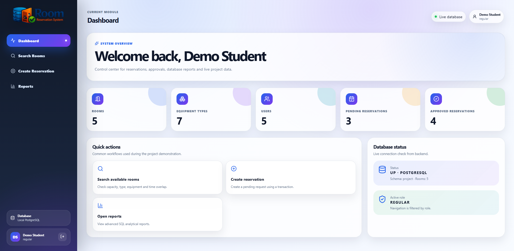
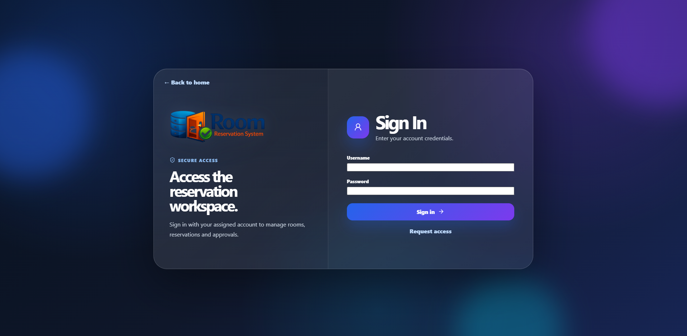
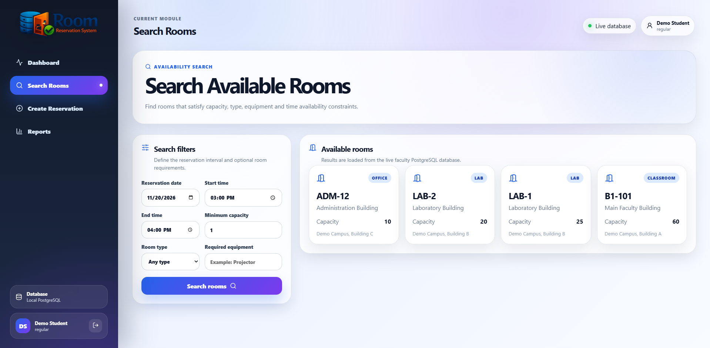
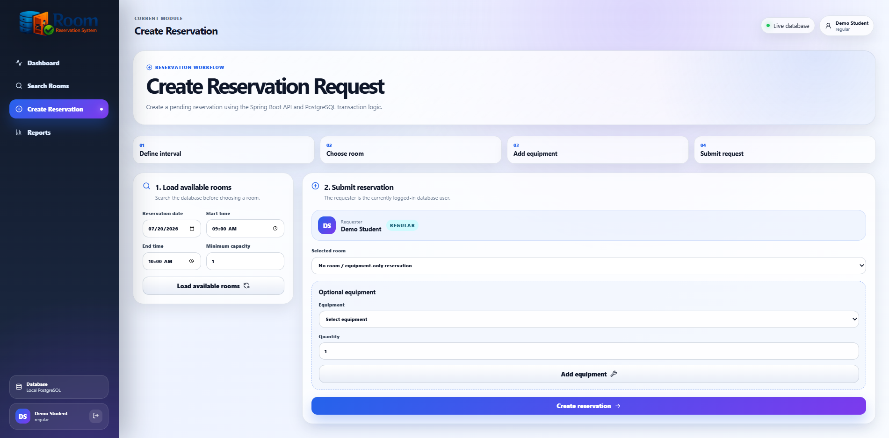
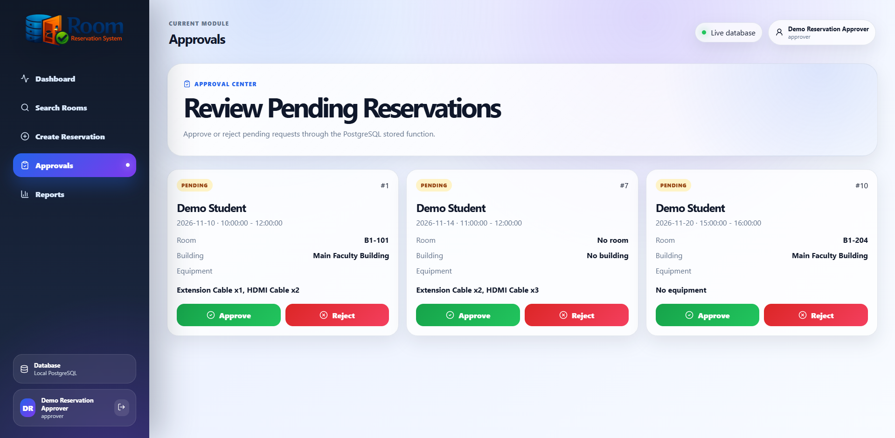
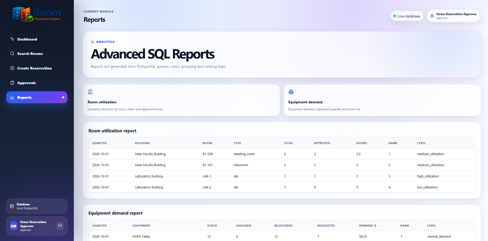

# Room Reservation System

[](https://github.com/nikolasarafimov/room-reservation-system/actions/workflows/ci.yml)

A full-stack reservation management platform for shared rooms and equipment. Built as a database-oriented academic project and extended into a containerized web application with role-based access control, transactional approval workflows, reporting, and automated tests.

**Stack:** Java 21 · Spring Boot 3.3.5 · Spring Security · Spring JDBC · PostgreSQL 16 · React · Vite · Nginx · Docker Compose · JUnit 5 · Mockito · Testcontainers · GitHub Actions

> **Project status:** Local-development / portfolio demonstration. The application uses seeded test data and is **not configured for public production deployment**.

## Features

## Application Preview

Explore the main features of the Room Reservation System through its interactive interface.

### Dashboard

A centralized overview of rooms, equipment, users, pending reservations, and approval statistics.



### Authentication & Room Availability

| Secure Authentication | Room Availability Search |
|:---:|:---:|
|  |  |

### Reservation & Approval Workflow

| Create Reservation | Reservation Approvals |
|:---:|:---:|
|  |  |

### Analytics & Reporting

Analyze room utilization, reservation statuses, and equipment demand through PostgreSQL-powered reports.



- **Availability search** — filter rooms by date, time interval, capacity, type, and required equipment; exclude occupied rooms.
- **Reservation requests** — request rooms and/or equipment, with validation and `pending` status.
- **Approval workflow** — approve or reject requests through PostgreSQL-backed business logic.
- **Role-based access** — separate `regular`, `approver`, and `admin` permissions, enforced on the server.
- **Session-based authentication** — Spring Security, BCrypt password hashes, HttpOnly session cookies, and CSRF protection.
- **Access control** — request ownership is determined from the authenticated identity, not client-supplied user IDs.
- **Analytics** — room utilization and equipment demand reports using PostgreSQL queries and views.
- **Reproducible local stack** — Docker Compose runs the database, backend, and Nginx-served frontend.
- **Automated checks** — unit, authorization, validation, API error-handling, and Testcontainers-backed PostgreSQL integration tests.

## Architecture

```text
Browser
   |
   v
React / Vite build served by Nginx (:3000)
   |  /api reverse proxy
   v
Spring Boot + Spring Security (:8080)
   |  JDBC
   v
PostgreSQL 16 (internal :5432; host 127.0.0.1:5433)
   |
   +-- project schema: rooms, users, reservations, approvals, equipment
   +-- views, SQL functions, triggers, and indexes
```

The backend uses Spring JDBC rather than an ORM. SQL definitions and example data are versioned in the [`database/`](database/) directory.

## Quick start (Windows PowerShell + Docker Desktop)

**Prerequisites:** Git, Docker Desktop with Linux containers enabled, and PowerShell. Java and Node.js are **not required** for the Docker-based launch.

### 1. Clone and configure

```powershell
git clone https://github.com/nikolasarafimov/room-reservation-system.git
cd room-reservation-system
Copy-Item .env.example .env
```

Edit `.env` and replace `CHANGE_ME_TO_A_STRONG_LOCAL_PASSWORD` with a strong, unique password. **Do not commit `.env`.** The example account and database names are intended for local development.

### 2. Start the local database

```powershell
docker compose up -d db
docker compose ps
```

The database should reach the `healthy` state before initialization.

### 3. Initialize the database (new, empty volume only)

Run these scripts **once**, in order, against the local `room_reservation` database. They are designed for a fresh schema and seeded demo data, not for repeated execution or production migrations.

```powershell
$files = @('01_schema.sql', '02_seed.sql', '03_advanced.sql', '05_auth_schema.sql')
foreach ($file in $files) {
    docker cp ".\database\$file" "room-reservation-db:/tmp/$file"
    if ($LASTEXITCODE -ne 0) { throw "Copy failed: $file" }

    docker compose exec -T db psql -X -v ON_ERROR_STOP=1 --single-transaction -U roomreservation -d room_reservation -f "/tmp/$file"
    if ($LASTEXITCODE -ne 0) { throw "Database initialization failed: $file" }
}
```

This creates the `project` schema, eight core tables, seed records, reporting and approval SQL objects, plus authentication fields. The scripts have a database-name safety check but **must not** be run against unrelated databases.

### 4. Set local demo account passwords

```powershell
.\scripts\provision-demo-passwords.ps1
```

The script prompts privately for distinct passwords for the seeded `student1`, `approver1`, and `admin` accounts. It generates BCrypt-compatible hashes in PostgreSQL using `pgcrypto`. Passwords are not committed or written to `.env` by the script. **Never reuse real account passwords for demo users.**

| Username | Role | Access |
| --- | --- | --- |
| `student1` | `regular` | Search rooms and create requests |
| `approver1` | `approver` | Review and decide reservations |
| `admin` | `admin` | Administrative access and approvals |

The other seeded user records do not have passwords until separately provisioned. Self-registration is not currently implemented.

### 5. Build and launch the application

```powershell
docker compose up -d --build
docker compose ps
```

Open **http://localhost:3000**, select **Login**, and use one of the passwords you created. The backend is available at `http://localhost:8080` from the host, and all exposed ports bind to `127.0.0.1` by default.

To view the logs:

```powershell
docker compose logs --tail=80 backend
docker compose logs --tail=40 frontend
```

To stop the application while **preserving** the PostgreSQL named volume:

```powershell
docker compose down
```

Do **not** run `docker compose down -v` unless you intentionally want to delete the local database volume and all its data.

## Core API endpoints

Endpoints other than health and CSRF-token initialization require authentication. Write requests use CSRF protection.

| Method | Endpoint | Purpose |
| --- | --- | --- |
| `GET` | `/api/health` | Backend and database health |
| `GET` | `/api/auth/csrf` | Obtain session CSRF token |
| `POST` | `/api/auth/login` | Log in with form-encoded credentials |
| `GET` | `/api/auth/me` | Get authenticated user |
| `POST` | `/api/auth/logout` | End session |
| `GET` | `/api/rooms` | List rooms |
| `POST` | `/api/rooms/search` | Search available rooms |
| `POST` | `/api/reservations` | Create reservation request |
| `GET` | `/api/reservations/{id}` | View authorized reservation details |
| `GET` | `/api/reservations/pending` | List pending requests (approver/admin) |
| `GET` | `/api/reports/room-utilization` | Room utilization report |
| `GET` | `/api/reports/equipment-demand` | Equipment demand report |
| `GET` | `/api/users` | User administration (admin) |

The frontend communicates via Nginx's same-origin `/api` reverse proxy.

## Database design

The core `project` schema consists of eight tables:

`buildings` · `rooms` · `equipment` · `room_equipment` · `users` · `reservations` · `reservation_equipment` · `approvals`

Additional objects include:

- `v_pending_reservation_details` — pending requests and associated metadata.
- `v_quarterly_room_utilization` — room usage statistics by quarter.
- `fn_approve_or_reject_reservation` — approval/rejection workflow.
- Triggers for reservation overlap checks and approver validation.
- Indexes supporting lookup and reporting queries.

See [`database/`](database/) for the SQL definitions and seed data.

## Tests and CI

GitHub Actions runs separate backend and frontend jobs on pushes and pull requests. The backend job executes **35 selected tests**, including Testcontainers-backed PostgreSQL integration tests; the frontend job runs `npm ci` and the Vite production build.

To run the selected tests locally (requires Java 21, Maven wrapper, and Docker for Testcontainers):

```powershell
cd backend
.\mvnw.cmd "-Dtest=SecurityAuthorizationTests,ReservationAuthorizationTests,ReservationValidationTests,ApiExceptionHandlerTests,PostgreSqlIntegrationTests" test
```

To build the frontend locally (requires Node.js 22):

```powershell
cd frontend
npm ci
npm run build
```

CI workflow: [`.github/workflows/ci.yml`](.github/workflows/ci.yml).

## Project structure

```text
.github/workflows/ci.yml     CI pipeline
backend/                     Spring Boot REST API and tests
frontend/                    React UI and Nginx configuration
database/                    Schema, seed data, SQL logic and validation scripts
scripts/                     Local demo-account password provisioning
.env.example                 Safe configuration template
docker-compose.yml           Three-service local stack
```

## Security and deployment notes

The application demonstrates authentication, authorization, BCrypt password hashing, session handling, CSRF protection, and server-side ownership checks. **It is not a production security certification.** Additional work is required before deployment to a public environment, including TLS/secure-cookie deployment settings, login rate limiting, user provisioning and recovery, audit logging, secrets management, and operational hardening.

The repository contains demonstration-only users and data, not production credentials. Never commit `.env`, private keys, actual database dumps, or real user data.

## Author

Developed by [Nikola Sarafimov](https://github.com/nikolasarafimov) as an academic database project and full-stack software engineering portfolio piece.
